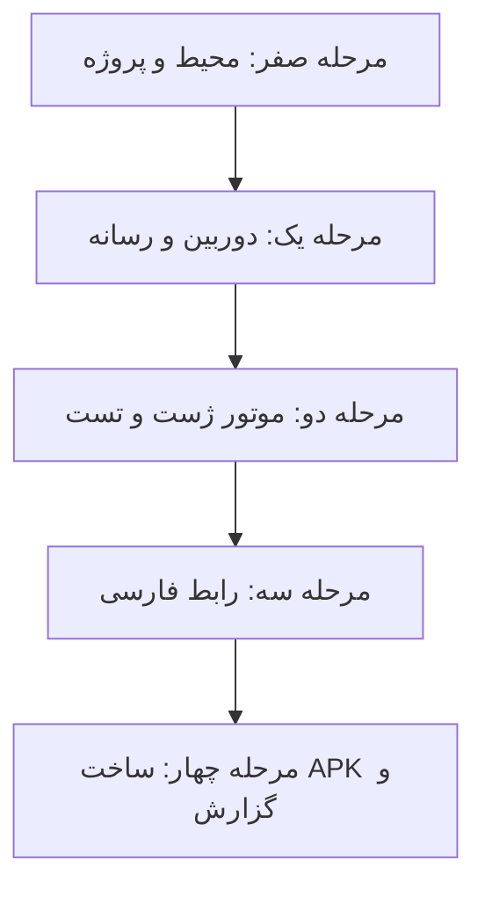

# پلن اجرای AirTouch

این سند پلن کاری نسخه اول است. منبع تصمیم‌ها فایل [p2.md](p2.md) است و هدف محصول در [p1.md](p1.md) ثابت می‌ماند. جایی که این سه اختلاف داشته باشند، برای پیاده‌سازی [p2.md](p2.md) مرجع است و [p1.md](p1.md) تغییر نمی‌کند.

خروجی این پلن یک اپ نصب‌شدنی است، نه یک نمونه نمایشی. تشخیص دست محلی و آفلاین است، فرمان‌ها با یک دست اجرا می‌شوند، و کنترل موسیقی از مسیر استاندارد اندروید انجام می‌شود.

## دامنه نسخه اول

- زبان برنامه Kotlin، رابط Jetpack Compose، چیدمان راست‌به‌چپ و متن فارسی است.
- حداقل نسخه اندروید ۹، API ۲۸ است. compileSdk و targetSdk روی ۳۶ می‌مانند.
- شناسه برنامه `com.airtouch.app` است.
- دوربین جلو و عقب از تنظیمات انتخاب می‌شود. پیش‌فرض دوربین جلو است و اگر نباشد دوربین عقب با پیام روشن استفاده می‌شود.
- تشخیص دست با MediaPipe Hand Landmarker و فایل [app/src/main/assets/hand_landmarker.task](app/src/main/assets/hand_landmarker.task) داخل APK انجام می‌شود. دانلود مدل در زمان اجرا مجاز نیست.
- فرمان‌ها: آهنگ بعدی، آهنگ قبلی، پخش/توقف، زیاد کردن صدا، کم کردن صدا، بی‌صدا/بازگشت صدا، تعلیق با مشت و ادامه با کف دست باز.
- AirTouch پخش‌کننده داخلی ندارد. مقصد، نشست رسانه برنامه‌های دیگر است.
- دوربین فقط با اقدام کاربر و از صفحه قابل‌مشاهده شروع می‌شود. بعد از خاموشی صفحه، reboot یا force-stop خودش روشن نمی‌شود.
- اینترنت برای خود اپ لازم نیست و مجوز `INTERNET` در مانیفست نهایی نباید بماند.

## تصمیم‌های قفل‌شده

- Gradle Wrapper 8.13، Android Gradle Plugin 8.13.2 و Kotlin 2.3.21. خروجی بایت‌کد Java 17 است.
- CameraX 1.5.3، MediaPipe tasks-vision 1.2.3، Compose BOM 2025.10.01، DataStore 1.1.7.
- وابستگی شناور ممنوع است. OpenCV، Hilt، Room، Navigation، ExoPlayer و Firebase اضافه نمی‌شوند.
- مالک دوربین سرویس پیش‌زمینه از نوع `camera` است، نه Activity. پیش‌نمایش از تحلیل تصویر جداست.
- دسترسی به نشست‌های موسیقی از NotificationListenerService و با روشن‌کردن آگاهانه کاربر است. مجوز نمایش اعلان از دسترسی به اعلان‌ها جدا توضیح داده می‌شود.
- بدون امکان نشان‌دادن اعلان، کنترل چندوظیفه‌ای شروع نمی‌شود. آزمایش دست داخل صفحه باز مجاز است و با ترک صفحه قطع می‌شود.
- حالت آزمایش فرمان رسانه نمی‌فرستد. برگشت به کنترل واقعی فقط با اقدام صریح کاربر است.
- کلید رسانه‌ای سراسری فقط وقتی گزینه fallback روشن باشد، هدف خودکار باشد و نشست قابل‌استفاده‌ای نباشد. برای یک ژست دو مسیر همزمان اجرا نمی‌شود.
- صدای رسانه محلی فقط `STREAM_MUSIC` است. در تماس یا خروجی با حجم ثابت، فرمان صدا رد می‌شود.
- هیچ فریم، ویدئو یا نام آهنگ در فایل یا لاگ ذخیره نمی‌شود. پشتیبان ابری داده اپ خاموش است.

## قرارداد حرکت

- راست و چپ از دید کاربر در پیش‌نمایش است. دوربین جلو آینه‌ای و دوربین عقب بدون آینه به موتور داده می‌شود.
- بالا و پایین مطابق تصویر جاری گوشی است. هر سوایپ کامل فقط یک فرمان است و برگشت دست فرمان معکوس نیست.
- تماس شست و اشاره، با بازبودن انگشت‌های دیگر، پخش/توقف است و فقط روی شروع تماس تأییدشده اجرا می‌شود.
- تماس شست و انگشت میانی بی‌صدا/بازگشت صدا است. تماس مبهم هیچ فرمانی نمی‌دهد.
- مشت یک‌ثانیه‌ای کنترل را معلق می‌کند و موسیقی را قطع نمی‌کند. در تعلیق فقط کف دست باز و ثابت کنترل را ادامه می‌دهد.
- بعد از گم‌شدن دست، تعلیق کاربر خودش لغو نمی‌شود.
- آستانه اولیه: اطمینان مدل ۰٫۶، پایدارشدن ۳۰۰ میلی‌ثانیه، پنجره حرکت ۱۵۰ تا ۵۰۰ میلی‌ثانیه، جابه‌جایی حداقل یک عرض کف دست و ۱۲ درصد تصویر، سرعت ۲٫۵ عرض کف دست بر ثانیه، ورود pinch زیر ۰٫۲۵ و خروج بالای ۰٫۴۰ عرض کف دست، مکث فرمان ۷۰۰ میلی‌ثانیه.
- حساسیت کاربر این آستانه‌ها را در محدوده امن عوض می‌کند و شرط بزرگ‌تربودن آستانه خروج از ورود حفظ می‌شود.
- ژستی که در زمان مکث شروع شده برای بعد ذخیره نمی‌شود.

## مرحله صفر

- JDK برای اجرای Gradle و Android SDK 36 از مسیر محیط توسعه تأمین می‌شود. `local.properties` وارد Git نمی‌شود.
- کاتالوگ نسخه در [gradle/libs.versions.toml](gradle/libs.versions.toml) ثبت می‌شود.
- مدل از منبع نسخه‌دار float16 دریافت و با SHA-256 مدل‌کارت تطبیق داده می‌شود.
- Wrapper با checksum توزیع Gradle ساخته می‌شود.

## مرحله یک

- [app/src/main/java/com/airtouch/app/service/HandTrackingService.kt](app/src/main/java/com/airtouch/app/service/HandTrackingService.kt) سرویس را در مهلت سیستم به پیش‌زمینه می‌برد، سپس مدل و دوربین را آماده می‌کند.
- تحلیل تصویر آخرین فریم را نگه می‌دارد، نرخ را محدود می‌کند و فریم عقب‌افتاده را روی هم انباشته نمی‌کند.
- [app/src/main/java/com/airtouch/app/service/MediaNotificationListener.kt](app/src/main/java/com/airtouch/app/service/MediaNotificationListener.kt) فقط برای نشست رسانه استفاده می‌شود.
- توقف از اعلان، صفحه برنامه و خاموش‌شدن صفحه باید منابع دوربین را آزاد کند.

## مرحله دو

- منطق ژست در [app/src/main/java/com/airtouch/app/gestures/GestureEngine.kt](app/src/main/java/com/airtouch/app/gestures/GestureEngine.kt) به دوربین و MediaController وابسته نیست.
- ویژگی دست، انتخاب نشست، تصمیم پخش و تصمیم صدا جداگانه و روی JVM تست می‌شوند.
- تست‌ها زمان واقعی صبر نمی‌کنند.

## مرحله سه

- صفحه‌های خانه، دوربین، حرکت‌ها، آزمایش دست و وضعیت موسیقی با متن فارسی و هدف لمس کافی ساخته می‌شوند.
- تنظیمات در DataStore می‌ماند. شروع بعدی برنامه دوربین را خودش روشن نمی‌کند.
- عنوان آهنگ با جهت متن محتوایی نشان داده می‌شود تا عبارت انگلیسی در چیدمان راست‌به‌چپ نشکند.

## مرحله چهار

- تست واحد، lint در حد قابل‌قبول و `assembleDebug` اجرا می‌شود.
- APK دیباگ واقعاً ساخته و با apksigner و zipalign بررسی می‌شود.
- بسته همه‌معماری به‌خاطر کتابخانه بومی MediaPipe از سقف ۱۰۰ مگابایت GitHub بزرگ‌تر است. خروجی نصب‌شدنی برای هر ABI جدا است و گوشی‌های رایج فایل `arm64-v8a` را می‌گیرند.
- APK ریلیز امضاشده ساخته نمی‌شود مگر کلید واقعی موجود باشد. کلید جعل نمی‌شود.
- تست روی گوشی واقعی و تست instrumentation فقط وقتی دستگاه متصل باشد اجرا می‌شود. نبود دستگاه در گزارش قید می‌شود.
- راهنمای نصب و حرکت‌ها در [readme.md](readme.md) نوشته می‌شود.

## معیار پذیرش همین اجرا

- موتور برای سوایپ، pinch، مشت، مکث، برگشت دست، دست چپ و راست و ورودی کهنه تست خودکار دارد.
- فایل APK دیباگ وجود دارد، حجمش صفر نیست و مدل را داخل خود دارد.
- موردی که روی دستگاه واقعی سنجیده نشده، سنجیده‌شده اعلام نمی‌شود.
